# Full-process simulation of radar signal processing system: from basic waveforms to distributed collaborative cooperation [with Python code]

Radar Signal Processing Core Theoretical System: From Fundamental Waveforms to Distributed Collaborative Radar Signal Processing Links, Covering Multiple Layers Including Electromagnetic Wave Propagation, Waveform Design, Target Detection, Parameter Estimation and Array Spatio-Temporal Adaptive Processing, among others. This paper systematically reviews key theoretical modules such as radar equations, LFM pulse compression, Doppler processing and MTD, CFAR detection, array beamforming and superresolution direction finding, MTI/STAP, MIMO virtual aperture, waveform design, and distributed multi-site fusion and time synchronization, aiming to provide a solid systematic reference for researchers in the fields of radar communication and deep learning. I. Introduction The essence of a radar system is extracting distance, velocity, angle, etc., from target echoes by transmitting electromagnetic waves and receiving them back. From single pulses to phase-coherent pulse trains, from fixed beams to adaptive spatio-temporal processing, from single-site detection to distributed collaborative, every aspect of signal processing is constrained by physical laws: the SNR decays with the fourth power of the distance, the compression gain is determined by the time-bandwidth product, Doppler ambiguity and distance ambiguity are coupled, the trade-off between array aperture and angle resolution, clutter peaks' spatio-temporal coupling characteristics... These underlying constraints are both challenges and sources of innovation for algorithm development.
This paper will focus on the full linkage of radar signal processing, systematically elucidating the following core theoretical modules:
Radar Equations: A quantitative relationship between power budget and detection range.
LFM Pulse Compression: Acquiring large energy and high resolution simultaneously through the time-bandwidth product.
Doppler Processing and MTD: Using slow time FFT to achieve velocity resolution and moving target detection.
CFAR Detection: Adaptive threshold maintaining constant false alarm rate.
Array Signal Processing: Beamforming, MVDR adaptive anti-interference, MUSIC/ESPRIT superresolution direction finding.
MTI and STAP: From time domain cancellation to spatio-temporal two-dimensional joint clutter suppression.
MIMO Radar: Orthogonal waveform diversity and virtual aperture expansion.
Waveform Design: OFDM multicarrier and phase coding fuzzy function characteristics.
Distributed Radar: Multi-site positioning, GDOP, phase-coherent/quasi-phase-coherent accumulation and PTP time synchronization.
This article aims to start from physical intuition and supplemented by mathematical derivations, to sketch out a comprehensive and extendable theoretical map for readers.
II. Radar Equation and Detection Fundamentals
2.1 Basic radar equation: The received signal power of a single-base station pulsed radar is:
Where Pt is the peak transmitting power, Gt is the antenna gain (shared between transmission and reception), λ is the wavelength, RCS is the target radar cross section (RCS), and r is the target distance. The receiver noise power is, where B is the Boltzmann constant, T is the standard noise temperature, N is the noise figure, and Bw is the receiver bandwidth. Therefore, the SNR of a single pulse is:
This formula reveals four key trends:
- Doubling the distance results in a 12 dB drop in SNR, which is fundamentally why radar detection distance is limited.
- Longer wavelengths are conducive to power propagation but have lower angle resolution.
- Clutter reduction through stealth technology reduces detectability.
- A wider bandwidth leads to greater noise power, which contradicts the paradox of pulse compression discussed in the next section.
2.2 Maximum detection distance and pulse energy: If the minimum detectable SNR is defined as (usually 13 dB), then the maximum detection distance can be calculated:
Noting that it is in the fourth root relationship, thus increasing peak power efficiency is extremely low. A more effective approach is to use pulse compression: maintaining peak power constant, increasing pulse width to increase emission energy while keeping distance resolution with a large bandwidth, thereby achieving a 2x SNR gain.
III. LFM Pulse Compression and Range Resolution
3.1 Contrast between range resolution and pulse compression: The minimum distance difference that two targets can be distinguished is, where B is the signal bandwidth. High resolution requires a large bandwidth, but large bandwidth often implies short pulses, which carry low energy and limit detection distance. Pulse compression is precisely designed to solve this contradiction.
3.2 Linear Frequency Modulation (LFM) Signal Model: The linear frequency modulation (LFM) signal changes its frequency linearly within one pulse:
Where t is the pulse width, B is the bandwidth, and K is the frequency modulation slope. The time-bandwidth product of LFM determines the performance of pulse compression.
3.3 Matching Filter and Compression Output
The pulse width is approximately, and the peak amplitude is amplified by a factor of 10 compared to the input. Since the noise power only increases linearly with the filter bandwidth, the SNR gain of **pulse compression** precisely equals the product of time-bandwidth (linear value), i.e., dB.
3.4 Sidelobe suppression and windowed matched filter output first sidelobe level is dB, which may mask weak targets. By adding windows (Hamming, Taylor, etc.), sidelobes can be suppressed below dB, but the main lobe will expand by about 1.5 times, i.e., trade resolution for dynamic range - this is an eternal basic trade-off in radar waveform design.
IV. Doppler Processing and MTD 4.1 The Doppler shift introduced by moving targets in a phase-coherent pulse train is (radial velocity, away from the radar, positive). A single pulse is transmitted within a phase-coherent processing interval (CPI), and the echoes of each pulse are not only delayed in time but also phase shifted, where the phase shift is represented by. The echoes of multiple pulses at the same range cell are sampled at slow time to yield a complex exponential sequence.
4.2 Slow Time FFT and MTD perform an FFT on the sequence, different energies will concentrate at different Doppler frequencies - this is the basic principle of **Moving Target Detection (MTD)**. The Rayleigh limit of the FFT gives a frequency resolution of , corresponding to a velocity resolution of:
Increasing the number of pulses can improve the speed resolution. By arranging the slow time FFT results of all distance units, i.e., the Distance-Doppler Matrix (RDM), it becomes the core data for subsequent detection and tracking.
4.3 Speed Blur and Distance Blur
Distance blur: The maximum unblurred distance is.
The PRF is increased but decreased, while the low PRF is the opposite. This contradiction is usually resolved through multiple PRF working modes or varying repetition rates.
5. CFAR (Constant False Alarm Rate) Detection
5.1 The drawbacks of fixed thresholds for radar receiver noise power dynamics with environmental factors (sea state, rain fade, clutter). Fixed detection thresholds can lead to drastic fluctuations in false alarm rate. **Constant False Alarm Rate (CFAR)** technology uses real-time estimation of noise power around the detection unit by local samples, adaptively adjusting the threshold to keep the false alarm probability constant.
5.2 The average CFAR (CFAR) threshold for CA-CFAR units is calculated as the arithmetic mean of training units, and the threshold factor is determined as follows:
CA-CFAR is optimal in uniform noise but suffers from masking effects due to adjacent strong targets in multi-target environments.
5.3 OS-CFAR (Ordered Statistics CFAR) and improved FCME (Frequency Domain Continuous Mean Excluding) utilize the sorted power of training units to select the value at the nth position (commonly used) as the noise estimate, showing insensitivity to multi-target masking. The improved FCME (Frequency Domain Continuous Mean Excluding) employs a segmented minimum mean block initialization for a clean set, effectively combatting partial band interference even when the interference bandwidth is large, maintaining low false alarms.
6. Array Signal Processing: Beamforming and Superresolution Direction Finding
6.1 Uniform linear arrays (ULAs) consist of isotropic elements with an element spacing typically taken as . The phase difference between plane waves arriving from directions (relative to the normal) at each element is given by , where , and the steering vector is:
The array factor (directional pattern) is . The uniform weighted directional pattern exhibits a sinc function, with a main lobe width of approximately 3 dB.
6.2 MVDR (Minimum Variance Distortionless Response) adaptive beamforming when there are strong directional interferences, fixed weights cannot form deep nulls in the interference direction. The MVDR beamformer solves the following constrained optimization:
The optimal weight vector is , where  is the covariance matrix containing interference + noise. MVDR can adaptively form deep nulls (>40 dB) in the interference direction while maintaining target direction gain unchanged, serving as a powerful tool for spatial anti-interference.
6.3 MUSIC and ESPRIT Super-Resolution Direction of Arrival Subspace Class Algorithms Break Through the Rayleigh Limit, Achieving Angle Super-Resolution.
MUSIC: It involves feature decomposition, selecting the noise subspace (corresponding to the smallest eigenvalue), constructing a pseudo spectrum: The directional vector of the signal in the direction of interest is orthogonal to the noise subspace, making the denominator approach zero, sharpening the spectral peak. The resolution of MUSIC is limited only by the SNR and number of pulses, not by array beamwidth.
ESPRIT: By leveraging the translation invariance of ULA, it divides the array into two overlapping subarrays, calculates angles directly by solving the rotationally invariant relationship's eigenvalues without needing spectral search, thus achieving higher computational efficiency than MUSIC.
VII. Active Target Indicator and Space-Time Adaptive Processing
7.1 MTI Equalizer Ground clutter concentrates near zero Doppler. Active Target Indicator (MTI) suppresses stationary clutter through adjacent pulse pair cancellation:
2 Pulse Pair Canceller: Its transfer function.
3 Pulse Pair Canceller: Deeper nulls, capable of suppressing clutter with broader spectral width.
MTI cannot suppress moving clutter (such as rain clutter), and its velocity response to moving targets varies with changes (blind velocity problem).
7.2 Airborne Radar Clutter Coupling Between Time and Space: When an airborne radar looks down at the ground, ground clutter due to platform motion results in Doppler broadening, coupled with Doppler frequency and azimuth angle:
Here, denotes the ground angle, and denotes the spatial frequency. On the plane of time-space two dimensions, clutter energy is distributed along a narrow clutter spine, which is the core starting point for STAP design.
7.3 Basic Principles of STAP: Spatial-Temporal Adaptive Processing (STAP) jointly utilizes the two dimensions of space (elements) and time (pulses) to adaptively form a recessed corner in the direction of the clutter spine. The spatiotemporal joint steering vector is:
Where denotes the time-domain steering vector, and denotes the Kronecker product. The weight values of STAP are similar to those of MVDR, but the covariance matrix includes clutter, interference, and noise. Full-dimensional STAP theoretically achieves an improvement factor of 30–60 dB, but requires computational complexity, and approximately one independent identically distributed training sample, often using dimensionality reduction STAP (e.g., mDT, post-Doppler adaptive).
8. MIMO radar and virtual aperture extension
8.1 Orthogonal waveform diversity MIMO radar emits orthogonal waveforms (e.g., different phase encoding or OFDM subcarriers) from each transmit array element, while the receiver separates signals from each transmission channel through matching filtering. Consequently, each transmit array element and each receive array element can be equivalent to an additional virtual array element. For an Uniform Linear Array (ULA), if the physical array spacing is, the virtual array spacing becomes, and the virtual aperture extension becomes.
8.2 Virtual array directional pattern The steering vector of the virtual array is determined by the positions of all virtual elements. Since there are far more virtual elements than physical ones, the main lobe of the MIMO radar's directional pattern is narrower and sidelobes lower, significantly outperforming traditional phased arrays in angle resolution. Additionally, orthogonal waveforms can provide waveform diversity gain to combat target blinking and angle blinking.
8.3 Convolutional function and orthogonality The auto-correlation of orthogonal waveforms should have low sidelobes, and the cross-correlation should be as small as possible. The Barker code (up to 13 bits) has the optimal peak sidelobe ratio in dB, but its length is limited; Frank multiphase codes and random phase codes can be designed for any length, but their Doppler tolerance varies. OFDM waveforms achieve good cross-correlation through subcarrier orthogonality, but their peak-to-average ratio is high, necessitating trade-offs.
9. Waveform Design: Convolutional Function and Multicarrier System
9.1 Convolutional function The convolutional function is defined as the inner product between the signal and its time-delayed-Doppler replica:
It describes the signal's ability to resolve at distance-Doppler plane. An ideal "pincushion" shaped convolutional function has a narrow main lobe and flat sidelobes, capable of simultaneously achieving high distance and velocity resolution.
9.2 LFM's convolutional function The convolutional function of LFM signals is skewed, with its contour lines being inclined ellipses. This means that LFM suffers from inherent weaknesses due to the distance-Doppler coupling effect: distance measurement errors will shift with target speed changes, which is its inherent flaw.
9.3 OFDM waveforms OFDM achieves flexible resource allocation in the time-delay-Doppler domain by transmitting multiple orthogonal subcarriers in parallel. Its baseband signal can be represented as:
Subcarrier orthogonality ensures that the distortion function of OFDM approximates a spike, and it can be flexibly controlled by subcarrier weighting. Therefore, it is widely used in communication-perception integrated systems.
10. Distributed Radar: Multi-site Fusion and Time Synchronization
10.1 Multi-site positioning with GDOP utilizes distance measurements from multiple receiving stations for multi-point positioning. Assuming the station positions are denoted as, and the measured distances are, then:
By subtracting the linearized reference station, the minimum variance unbiased estimate (MVUE) of the target position is solved using least squares. The geometrical accuracy factor (GDOP) is defined as:
Where is the direction cosine matrix. When the target is at the center of the station network, GDOP is minimal (optimal geometric), but it sharply increases when the target is far from the station network. The localization RMSE is approximately, and the standard deviation of range measurement error is.
10.2 Coherent/Quasi-coherent/Non-coherent Accumulation of Distributed Radars can choose different fusion strategies based on phase synchronization precision:
Full coherent: Directly summing signals from all stations, SNR gain = dB (upper bound).
Quasi-coherent: Estimating phase first and compensating for residual phase errors, using the coherence factor for the remaining phase error, SNR gain =. For Gaussian phase errors,.
Non-coherent: Simply adding power, no SNR gain (0 dB), but has the strongest robustness.
10.3 PTP Time Synchronization IEEE 1588 Precision Time Protocol (PTP) measures clock offset and link latency through master-slave bidirectional message exchange:
Where is the master station's sync timestamp, is the slave station's sync timestamp, is the slave station's send delay request timestamp, and is the master station's receive delay request timestamp. When the uplink and downlink links are symmetric, this formula precisely calculates the clock offset. Allan variance is a standard tool for evaluating clock stability (white frequency noise vs random walk noise) and is crucial for the design of phase synchronization in distributed radar.
XI. Summary and Outlook
This paper starts from the radar equation, traversing through the emission waveforms, pulse compression, Doppler processing, CFAR detection, array spatial processing, STAP, MIMO virtual aperture, waveform design to distributed multi-site fusion and synchronization of links, systematically combing the core theoretical system of radar signal processing. Each module has its clear physical constraints and mathematical structure behind it, which together form the basic theoretical framework of modern radar systems.
With the rise of cognitive radar, deep reinforcement learning anti-interference, and integrated communication and perception, radar signal processing is moving from "fixed models" towards a hybrid paradigm of "data-driven + model-driven." However, underlying theories such as radar equations, matched filtering, fuzzy functions, Cramer-Rao bounds, and space-time adaptive processing will remain indispensable foundations. This article aims to provide researchers in the fields of radar, communication, and deep learning with a clear theoretical map, aiding in exploring more intelligent and collaborative perception technologies.
The author is a researcher in the field of radar communication and deep learning. This article is one of a series of technical notes, and welcomes exchange and correction.

## Images

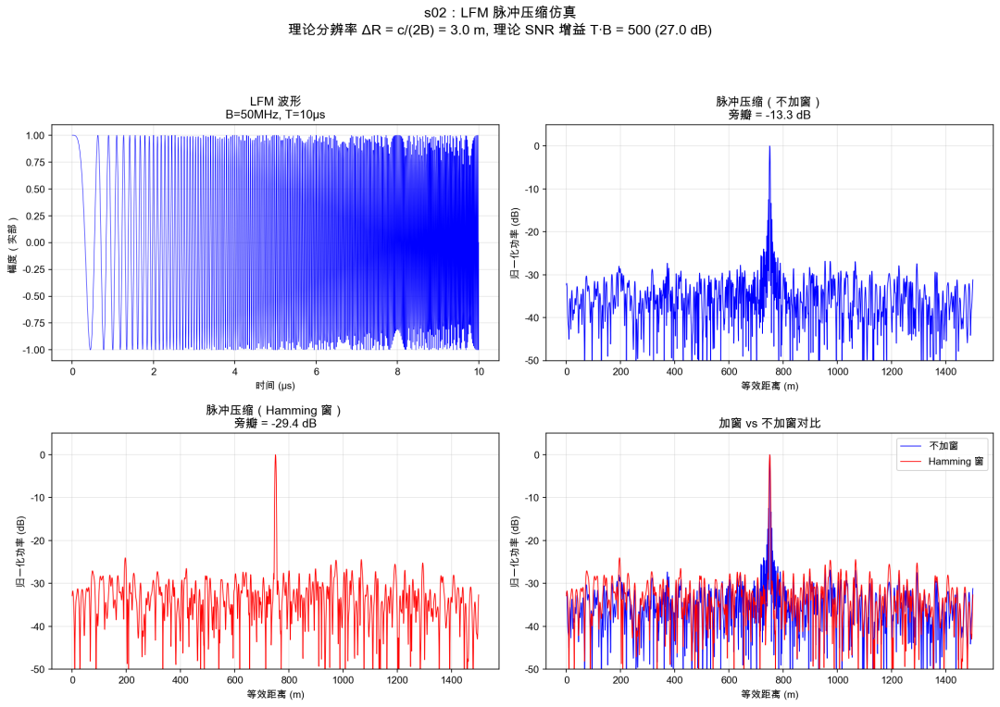
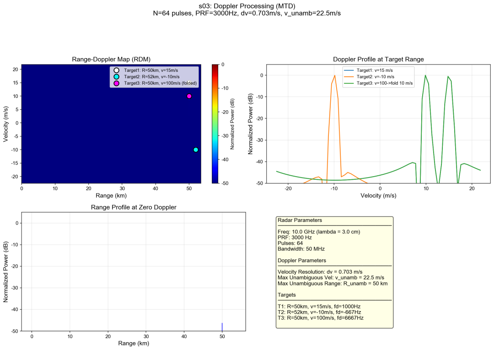
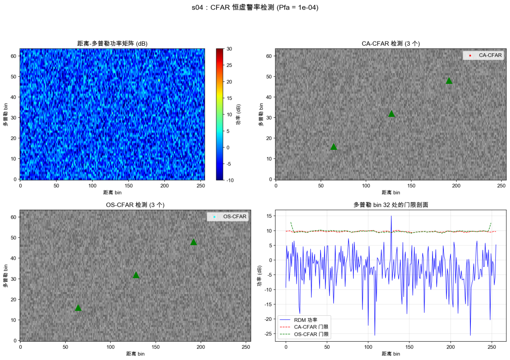
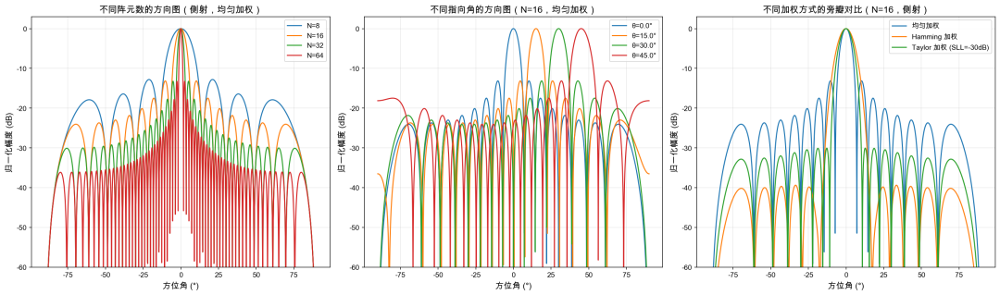
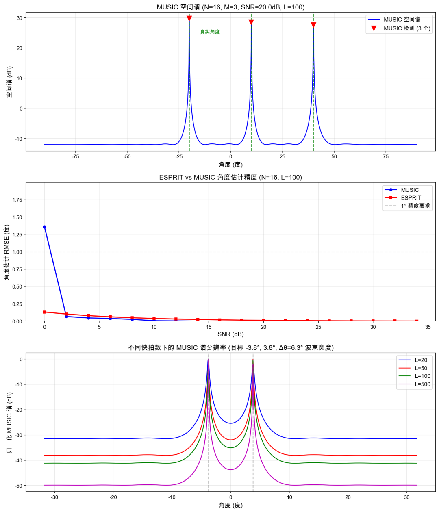
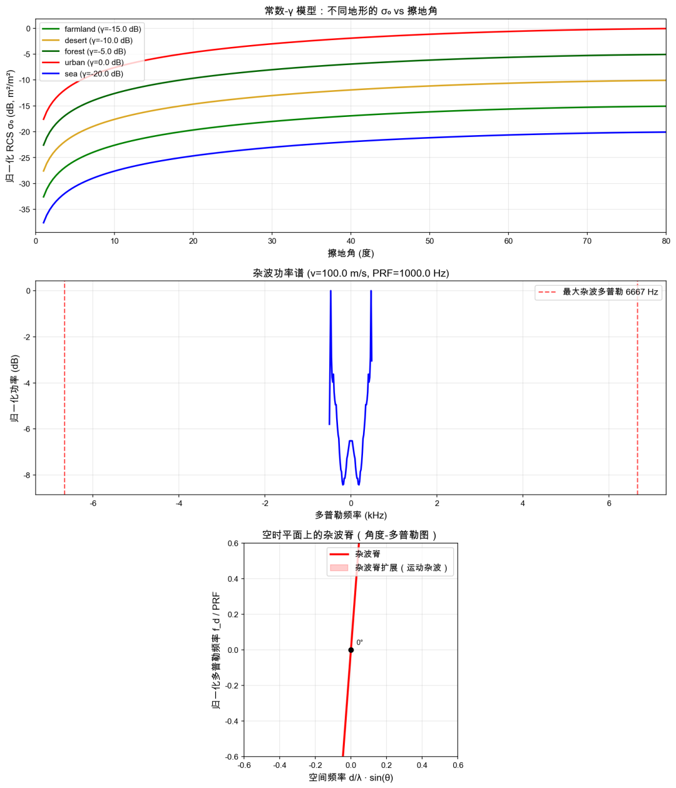
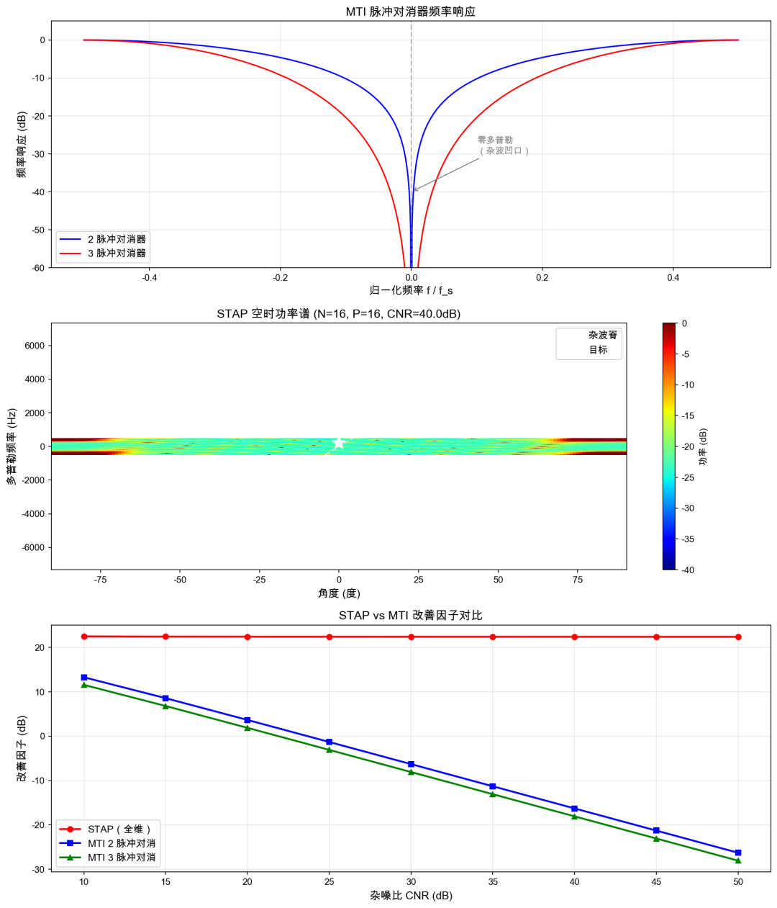
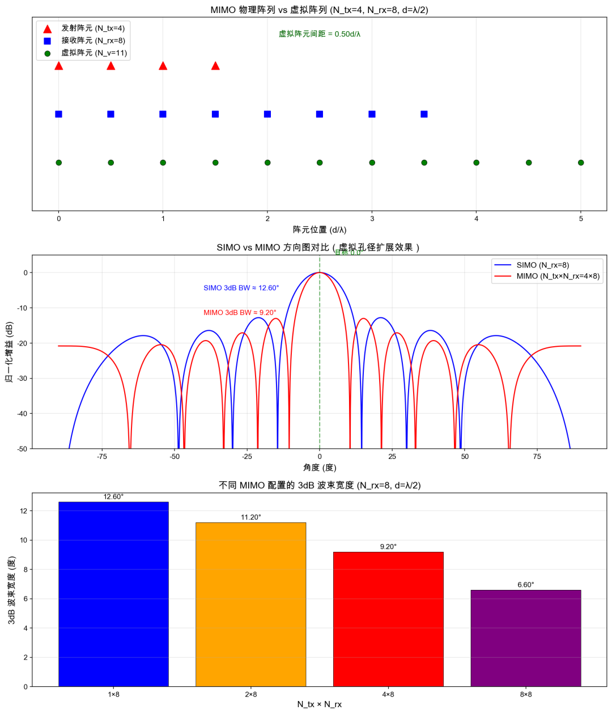
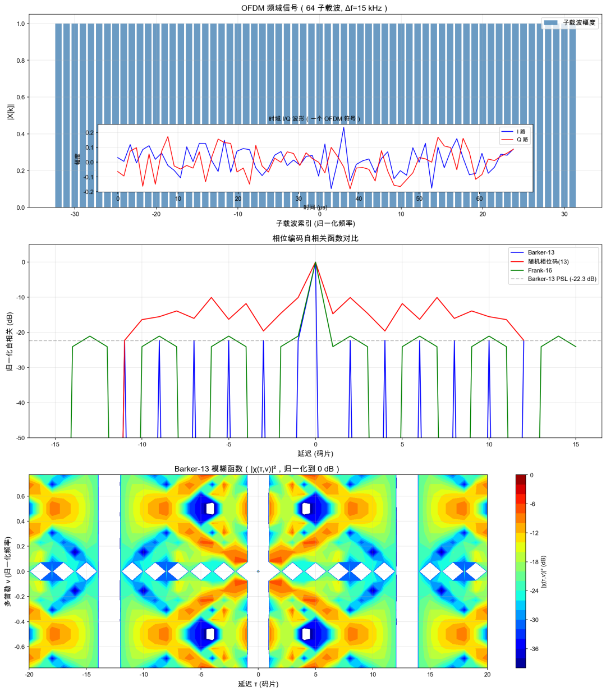
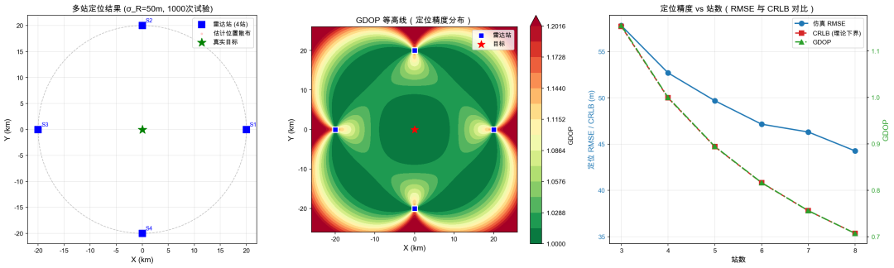
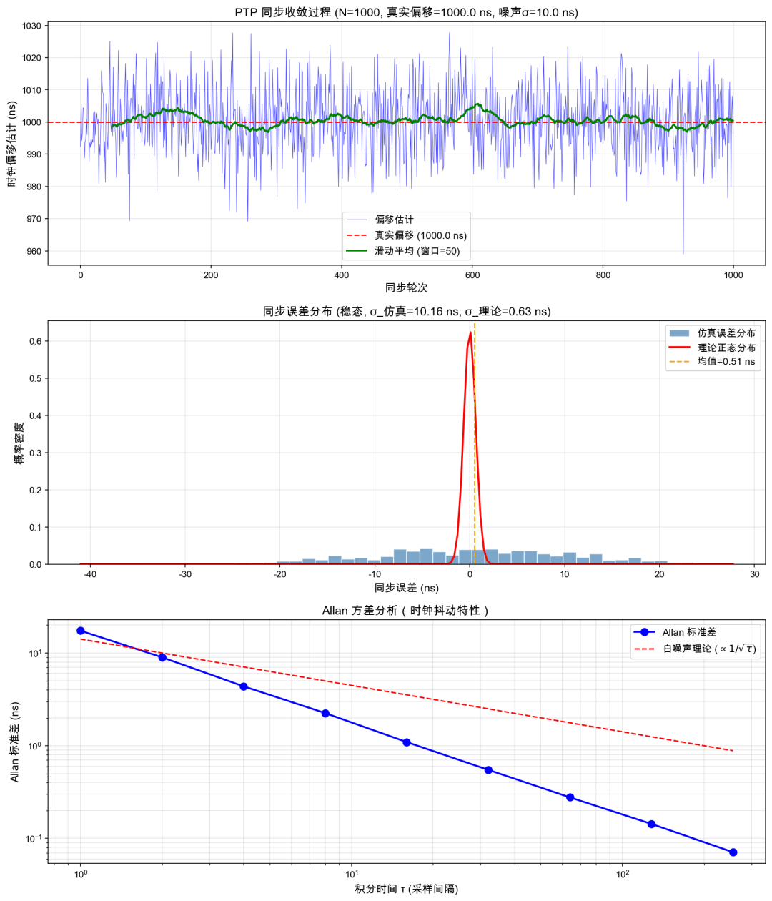

<!-- PAYMENT_BLOCK -->

## Get this dataset

- Payment link (Stripe): [Buy now](https://buy.stripe.com/3cs8yP7sY87d0vu9AB)
- Payment QR code: 

<!-- /PAYMENT_BLOCK -->
